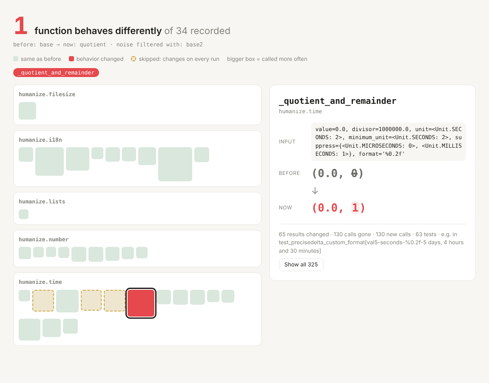

# runsnap

Record what your Python code **actually does** while your tests run: every call's real arguments, return value or exception. Then:

- **Diff it** before and after an AI agent (or a person) changes the code, and get a list of behavior that changed, even when every test still passes.
- **Let the agent look it up** over MCP instead of guessing what values a function receives.

```
$ runsnap diff before after --rerun before2

Behavior changed: 1
  shop.total(items=[100, 50])
      in test_shop.py::test_checkout
      before: returns 157.5
      after:  returns 159.0
```

## Why

Coding agents change code they did not write, and tests often do not pin down everything the code does. In a 2026 study of multi-step feature work, agents went back and noticed an earlier mistake in only about 5% of the later steps ([FeatureArc, arXiv:2610.37434](https://arxiv.org/abs/2610.37434)). "Which behavior did this change touch?" should not depend on the agent noticing.

## What it found

We asked Claude Code and Codex to refactor four files from humanize, python-slugify and toolz without changing behavior. All 8 refactors passed the projects' tests. runsnap confirmed that 6 kept every recorded result the same, and pointed at the other 2: in both, an empty input now returns a different kind of iterator (`interpose('a', [])` returns `itertools.chain` instead of `list_iterator`), which no test checks. In a separate experiment with 240 small injected bugs, it showed a changed result for 4 of the 45 the tests ran but missed. Details and raw data: [eval/](eval/).

## Install

Python 3.12+ (uses `sys.monitoring`).

```
pip install "runsnap[mcp] @ git+https://github.com/panyuti-ai/runsnap"
```

## Use

```
# 1. record before the change (twice, so values that change on every run can be ignored)
pytest --runsnap=before  --runsnap-module=mypkg
pytest --runsnap=before2 --runsnap-module=mypkg

# 2. let the agent (or yourself) change the code, then record again
pytest --runsnap=after --runsnap-module=mypkg

# 3. see what changed
runsnap diff before after --rerun before2        # --json for machines, --fail to exit 1 on changes

# 4. or see it as a page: every recorded function is a box, the ones that changed are red
runsnap diff before after --rerun before2 --html report.html
```



The report above comes from the mutation experiment in [eval/](eval/): one `0` changed to `1` in humanize, which its own tests did not catch.

Other commands: `runsnap calls SNAPSHOT FUNCTION [--test NAME]`, `runsnap slowest SNAPSHOT`, `runsnap list`.
You can also set `runsnap_modules = mypkg` in your pytest ini instead of passing `--runsnap-module`.

## Claude Code plugin

The plugin does the recording and the diff for you, every turn, and tells Claude what changed:

- before Claude's first edit of a `.py` file in a turn, it records your tests (twice, to learn what changes on every run);
- when Claude is about to finish, it records them again and compares;
- if any call now returns a different result for the same input, Claude is asked once to explain the change to you or fix it. Otherwise you see one line: `runsnap: same results for all compared calls`.

Install runsnap in the project's environment (see above), then in Claude Code:

```
/plugin install runsnap --marketplace panyuti-ai/runsnap
```

and opt the project in with `.claude/runsnap.json`:

```json
{"modules": ["mypkg"], "tests": ["tests"], "python": ".venv/bin/python"}
```

What it looks like: we gave Claude Code the refactor prompt from [eval/](eval/) on toolz `itertoolz.py` with the plugin loaded. Claude made 19 edits to the file, ran the 187 tests, and also compared old and new versions on about 17,000 random inputs of its own; everything matched, and it reported that behavior was unchanged. Then the Stop hook said:

```
runsnap recorded the tests before and after your edits. 1 call now returns a different result
for the same input (187 passed, 1 skipped in 1.34s):

- toolz.itertoolz.interpose(el='a', seq=[])
    in toolz/tests/test_itertoolz.py::test_interpose_empty
    before: returns <list_iterator object at 0x…>
    now:    returns <itertools.chain object at 0x…>
```

Claude answered that its shorter `interpose` returned a different kind of empty iterator, put the original code back, and re-ran the tests. Full transcript excerpt and patch: [eval/results/plugin-demo/](eval/results/plugin-demo/).

`python` defaults to `.venv/bin/python` when it exists. Each turn that edits Python runs your tests three times, so this suits suites that take seconds, not minutes. Recordings and the HTML report go to `.runsnap/claude/`; add `.runsnap/` to `.gitignore`.

## For agents (MCP)

```
claude mcp add runsnap -- runsnap mcp
codex mcp add runsnap -- runsnap mcp
```

Tools: `list_snapshots`, `function_calls`, `behavior_diff`, `slowest_functions`, `tests_reaching`. Snapshots are read from `.runsnap/` in the working directory (or `RUNSNAP_DIR`).

## How it works

- A pytest plugin turns on `sys.monitoring` only while each test's body runs, and only for code in the modules you name; every other code location is switched off the first time it is seen.
- Arguments and results are stored as short, stable `repr` text (long values truncated, memory addresses blanked), one SQLite file per snapshot in `.runsnap/`.
- `diff` matches calls by test, function, arguments and occurrence. With `--rerun`, any function whose results already differ between two recordings of the unchanged code (timestamps, random values) is left out.

## Limits

- **A snapshot is what the code did, not what it should do.** If a bug was there before, the snapshot records it as normal.
- Calls are matched by their arguments. When a change alters a function's arguments (for example a new default value), its old and new calls show up as "no longer happen" and "new", not as "changed".
- Generators and async functions are skipped for now. Values are compared as text, so objects without a useful `repr` compare only by type.
- Recording costs time in the modules you name; keep `--runsnap-module` narrow.

## Development

```
pip install -e ".[mcp]"
python -m pytest
```

## License

MIT
